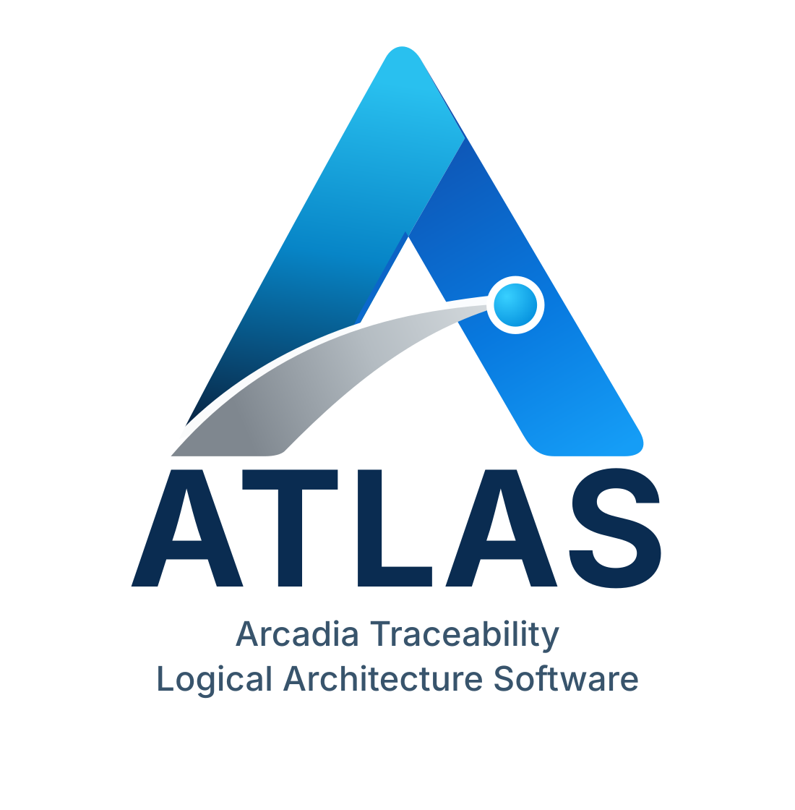

<p align="center">
  
</p>

<p align="center">
  <b>Arcadia Traceability, Logical Architecture Software</b><br>
  Strumento desktop di modellazione ARCADIA per l'EVC ERTMS di bordo<br>
  <sub>RFI - Ricerca e Sviluppo - Sviluppo Sistemi · versione 0.6.0</sub>
</p>

> [!WARNING]
> **ATLAS è ancora in corso di sviluppo.** Le funzionalità, il formato dei progetti e l'interfaccia possono
> cambiare tra una versione e l'altra. Alcune parti della metodologia non sono ancora coperte: vedi
> [Prossimi sviluppi](#prossimi-sviluppi).

---

ATLAS guida la modellazione ARCADIA del progetto EVC secondo i template della metodologia (cartella `Templates/`).
Importa le voci SRS dal SUBSET-026, ne gestisce la tracciabilità verso domini funzionali, funzioni e componenti,
e permette ai team di condividere il modello tramite un qualsiasi repository Git remoto. Funziona offline: il
repository serve solo per scaricare e pubblicare le versioni.

## Cosa è supportato oggi


**Modello ARCADIA**
- **System Analysis**: domini funzionali (SA-1), funzioni di sistema (SA-2), attori esterni, exchange item (SA-6),
  scambi funzionali (SA-5) e functional chain (SA-7).
- **Logical Architecture**: funzioni logiche (LA-2), componenti logici (LA-1), component exchange (LA-3) e
  realizzazioni delle chain (LA-4).
- **Elementi trasversali**:
  - team (EPBS-1), con referente e membri. Un solo team può essere la **Design Authority**: solo i suoi membri
    creano e modificano i team e assegnano i domini ai team. La DA aggiunge ogni membro con l'**ID del suo
    account locale**, che la persona le comunica: ATLAS la riconosce come membro, anche nelle versioni che
    pubblica. Il progetto si apre solo agli account che sono tra i membri dei team;
  - decisioni architetturali (X-1) e richieste di chiarimento (X-2), ciascuna con un elenco in tabella (doppio
    clic sul nodo dell'albero) da cui crearle, aprirle ed eliminarle;
  - domini funzionali (SA-1): il doppio clic sul nodo dell'albero apre una tab con ID, nome, team assegnatario,
    responsabile e stato di ogni dominio, il pulsante «Apri» della scheda e lo stato modificabile su ogni riga da un
    menu a tendina (colorato secondo lo stato; salvato subito, solo quel dominio). Allo stesso modo «SA-2 Funzioni
    di sistema» apre l'elenco delle funzioni, con dominio, numero di clausole e di requisiti derivati e stato;
  - funzioni di sistema (SA-2) e requisiti derivati (SA-4): «Mappa requisiti derivati…» nella scheda della
    funzione mappa i derivati sulla funzione, scelti a spunta sotto le clausole da cui sono derivati (una funzione
    di sistema per derivato).
- Le richieste di chiarimento sono indirizzate alla Design Authority o a un team, scelto alla creazione. La clausola
  si sceglie con una finestra a spunta.
- Negli ADR le voci SRS interessate si scelgono a spunta e «Superata da» da un elenco con ricerca.
- Le ADR hanno un **tipo** (nuovo dominio, fusione, scissione, eliminazione, ridefinizione dello scopo,
  riallocazione di una sezione, spostamento di una funzione, deroga…), scelto alla creazione: la scheda ha i campi
  propri di quel tipo, già compilati con ciò che si sa dall'elemento selezionato. Per ogni tipo c'è anche il
  template Excel corrispondente in `Templates/` (`Template_X-1.nn_ADR_<tipo>.xlsx`), con gli stessi campi della
  scheda; si rigenerano con `scripts/make_adr_templates.py` quando i campi cambiano.
- I tipi di ADR sono raggruppati per ambito (domini SA; voci SRS, funzioni e scambi SA; LA; generali). I dati che
  ATLAS conosce già (la missione attuale, i domini di una voce, il dominio di una funzione, i produttori di
  un'informazione) sono letti dal modello e non si riscrivono. La data della decisione la imposta ATLAS.
- Un dominio può escludere di proposito sezioni o clausole contenute nelle sue sezioni principali.
  - **Dove:** il pulsante «Escludi sezioni e clausole…» della scheda, tra l'elenco delle voci a cui il dominio
    contribuisce e quello delle escluse. Apre una finestra con le sole sezioni principali del dominio e il loro
    contenuto.
  - **ADR:** la spunta «Esclusa» apre subito l'ADR «Esclusione di sezione o clausola», per scriverne il motivo. La
    voce risulta esclusa solo quando l'ADR è salvata.
  - **Più voci:** la stessa ADR può escluderne altre, aggiunte dalla sua scheda.
- Ogni ADR ha il team e il membro proponente e una sezione «Decisione della DA», con l'esito e le osservazioni,
  modificabile solo dalla DA. Gli stati sono Proposta, In revisione DA, Revisionato DA, Decisa e Superata. Una
  riallocazione può riguardare più clausole, purché della stessa sezione.
- L'elenco X-1 mostra team, membro proponente, domini impattati, stato e decisione della DA, ordinabile con un clic sulle intestazioni.
  Le schede di dominio e di funzione elencano le ADR che le riguardano, con «Nuova ADR…» per crearne una.
- La Design Authority approva un'ADR di nuovo dominio con «Approva e crea il dominio»: ATLAS crea il dominio con
  il primo ID libero e gli alloca le sezioni indicate.
- «Esporta ADR aperte…» nell'elenco X-1 salva in Excel le ADR non ancora decise (ID, descrizione, team
  proponente, stato); lo stesso registro è anche un template (`Template_X-1.00_Registro_ADR_aperte.xlsx`).
- **Progetto › Genera › Schede Arcadia** scrive in Excel gli artefatti SA-1…SA-7 e le ADR scelti in **Progetto ›
  Genera › Impostazioni…** (scelta salvata nel progetto, cartella di destinazione per PC), compilati dal modello con
  il disegno dei loro template:
  - SA-1 e SA-2 hanno un foglio per dominio, nello stesso formato letto da «Importa clausole principali» e
    «Importa funzioni»;
  - SA-3, SA-4, SA-5 e SA-6 hanno un foglio unico, SA-7 un foglio per chain;
  - le ADR stanno in un unico file, con il registro delle aperte e un foglio per ADR;
  - gli artefatti senza dati non si possono scegliere, e si possono includere solo alcuni domini.

  I template SA (`Template_SA-n_*.xlsx`) hanno gli stessi campi delle schede di ATLAS e si rigenerano con
  `scripts/make_sa_templates.py`.
- I campi collegati tra schede diverse restano allineati: per esempio il team assegnato a un dominio compare tra i
  domini del team, e viceversa.
- Campi di testo libero con editor formattato (grassetto, corsivo, elenchi), salvati in Markdown, che si
  allungano con il contenuto.
- Identificativi automatici, una tab per ogni elemento aperto, schede in sola lettura finché non si passa in
  modalità modifica, con salvataggio o annullamento esplicito. Il clic destro su una tab la chiude, chiude le altre o
  tutte.
- Due salvataggi: **Salva** nella barra in alto (Ctrl+Maiusc+S) salva tutte le modifiche del modello, comprese
  quelle delle schede e delle viste aperte; il «Salva» di una scheda o di una vista, e **Ctrl+S** sulla tab
  corrente, scrivono solo le modifiche fatte da quella pagina.

**Viste grafiche della System Analysis**
- Il pannello a sinistra ha due schede, scelte dalla **barra di icone** sempre visibile sul bordo sinistro:
  **Modello**, con l'albero degli elementi, e **Viste grafiche**, con i diagrammi raggruppati per tipo e per SA
  (SA-1 domini funzionali, SA-2 funzioni per dominio, SA-5 dataflow, SA-7 catene e scenari). Un clic sull'icona
  della scheda aperta chiude il pannello, un clic su un'icona lo riapre su quella scheda (anche Ctrl+Maiusc+B, o
  trascinando il divisore fino al bordo). Un clic su un diagramma lo apre in una tab.
- **Vista complessiva** di SA-1 e di SA-2, prima in ciascun gruppo: un blocco per ogni dominio, con l'ID e il nome
  nella barra del titolo. In SA-1 i blocchi riportano solo il dominio; in SA-2 sono aperti sulle funzioni di
  sistema e sulle clausole tracciate, e un clic sul titolo (o sulla spunta a destra) li chiude e li riapre. Le
  funzioni con segnalazioni delle verifiche sono in rosso.
- Viste create dagli utenti, quante ne servono, con «Nuova vista…» o con il clic destro su un gruppo:
  - **domini funzionali** (SA-1) e **funzioni per dominio** (SA-2): solo i domini e le funzioni scelti; un dominio
    aggiunto mostra tutte le sue funzioni, le funzioni aggiunte da sole stanno nel blocco del loro dominio;
  - **dataflow funzionale** (SA-5): domini, funzioni di sistema e attori esterni; gli scambi tra gli elementi della
    vista compaiono da soli, con il dato scambiato e l'ID (linea continua per i FLOW, tratteggiata per gli EVENT,
    tratto e punto per le OPERATION), e ogni elemento conta i suoi scambi con elementi non aggiunti;
  - **catena funzionale** (SA-7): i passi di una functional chain, per dominio o per funzione, con i rimbalzi su un
    dominio già percorso in giallo (regola D4);
  - **scenario di scambio** (SA-7): la stessa catena come diagramma di sequenza, con una linea di vita per dominio
    (o funzione) e attore esterno e i messaggi raggruppati per ciclo.
- La vista si compone con gli elementi già presenti nel modello, dalla scheda **Elementi** del pannello a destra
  (trascinati o con doppio clic); «Riordina» li dispone in automatico. Il pannello a destra si apre e si chiude
  dalla sua barra di icone, come quello di sinistra (Ctrl+Alt+B); nei dataflow ha anche la scheda **Strumenti**.
- **Modifica del modello dalle viste**:
  - dalle viste di SA-1 (anche dalla vista complessiva) si creano **domini funzionali** con «Nuovo dominio…», da
    quelle di SA-2 **funzioni di sistema** con «Nuova funzione…»: ATLAS dà l'ID e l'elemento entra nel modello, tra
    gli elementi di tutte le viste e nella vista da cui è stato creato;
  - il **clic destro su un dominio**, in tutte le viste, mostra tutto quello che si può fare su di esso: aprirne la
    scheda, aprirlo o chiuderlo, mostrarne o aggiungerne alla vista le funzioni, nuova funzione, nuovo dominio,
    elimina. Il clic destro su una funzione la apre o la elimina;
  - l'**eliminazione chiede sempre** se togliere l'elemento solo dalla vista o anche dal modello (per una funzione,
    dal catalogo delle funzioni di sistema; per un dominio, a scelta anche con le sue funzioni), e la stessa finestra
    elenca gli elementi impattati: quelli che vi fanno riferimento e le viste da cui sparirà. Vale anche per Canc
    sugli elementi selezionati;
  - con i **connettori** del dataflow (FLOW, EVENT, OPERATION, nella scheda Strumenti) si traccia uno scambio da un
    **punto di attacco** di una funzione di sistema a quello di un'altra, o di un attore esterno: ATLAS crea lo
    scambio funzionale e il suo dato di interfaccia (un Exchange Item del dizionario o uno nuovo), con gli ID. I
    punti sono dodici per elemento, tre per lato, e se ne aggiungono quando un lato è pieno; il connettore scelto è
    evidenziato e gli elementi collegabili si illuminano al passaggio del mouse. Uno scambio con lo stesso
    produttore, utilizzatore e dato di uno già presente non si crea; un EVENT è prodotto sempre «Su evento»,
    un'OPERATION di norma «Su richiesta». Le maniglie alle estremità di una freccia portano l'estremità su un altro
    punto dello stesso elemento. Canc o clic destro sulla freccia eliminano lo scambio; se il dato non è più usato,
    ATLAS chiede se toglierlo dal dizionario, e se resta viene riproposto quando si ricollegano le stesse funzioni.
- **Disegno**:
  - nel dataflow le frecce sono a tratti orizzontali e verticali, girano intorno agli altri elementi e si
    ricalcolano quando si spostano le funzioni o i blocchi; le etichette si dispongono dove non si coprono;
  - un blocco trascinato si allinea a quelli vicini (bordi con bordi, centro con centro), con linee guida
    tratteggiate; altrimenti si posa sui puntini della griglia (ogni 20 px), che compaiono sulla tela bianca solo
    durante lo spostamento. Gli elementi si selezionano con un clic, Ctrl+clic o il riquadro (Maiusc + trascina su
    uno spazio vuoto), e trascinandone uno si sposta tutta la selezione;
  - la tela va oltre l'area visibile: con la mano si trascina uno spazio vuoto (o si usa il tasto centrale) per
    spostarsi, e un elemento portato verso il bordo fa scorrere la vista e allarga la tela;
  - il clic destro su uno spazio vuoto della tela offre lo **zoom** (avanti e indietro attorno al punto cliccato,
    dimensione reale, adatta alla finestra; anche Ctrl + rotella, Ctrl++, Ctrl+- e Ctrl+0), «Seleziona tutto» e,
    nei dataflow, la scelta di mostrare le maniglie su tutte le frecce o solo su quella selezionata;
  - **Ctrl+Z** annulla le ultime operazioni (spostamenti, elementi aggiunti o tolti, domini aperti, «Riordina»,
    elementi creati o eliminati dalla vista) e **Ctrl+Y** le ripete; **Ctrl+A** seleziona tutti gli elementi.
- Le modifiche al disegno restano nella tab (●) finché non si preme **Salva vista** (o Ctrl+S); chiudendo la vista
  con modifiche non salvate, ATLAS chiede se salvarle. Gli elementi creati o eliminati dalla vista si scrivono
  subito. Le viste sono schede del modello (`model/sa/views/`) e si pubblicano e si integrano come le altre; ogni
  vista si esporta come immagine PNG o SVG.

**Requisiti e tracciabilità**
- Import delle voci SRS dai PDF del SUBSET-026, con testo, tabelle e figure, e lettore delle voci diviso per
  capitolo.
- Registro di tracciamento (SA-3) e requisiti derivati (SA-4), con motivazione della derivazione e domanda B5.
- **Report di copertura** (pulsante nella pagina delle voci SRS): le clausole di bordo e di definizione coperte e
  scoperte e la copertura del subset, **per sezione** e **per clausola** (albero sezione → clausole fino all'ultima,
  con la categoria del cap. 9). Una voce è coperta se ha un dominio (suo o della sezione che la contiene, A4); il
  report indica anche le funzioni di sistema (SA-2) e i requisiti derivati (SA-4) che la coprono, con la
  percentuale di ciascun livello, filtri e ricerca; si esporta in Excel.
- Finestre di tracciatura a spunta, con ricerca, filtro per categoria (bordo, terra, definizioni, informative) e
  testo completo della voce con doppio clic:
  - domini → sezioni e clausole, come principale o contributore; le sezioni principali si importano anche dalla
    riga «Sezioni SRS principali» del foglio del dominio in un Excel SA-1 («Importa clausole principali…»:
    singole, gruppi come 4.8.1–4.8.5, riferimenti ad altri documenti segnalati; riepilogo prima di importare, con
    la colonna «Importa» per scegliere voce per voce e le voci allocate a più di un dominio indicate);
  - funzioni di sistema → sezioni e clausole; dalla scheda di una funzione («Importa funzioni da Excel SA-2…») o
    dal clic destro su «SA-2 Funzioni di sistema» nell'albero («Importa funzioni…») si importa il catalogo delle
    funzioni ipotizzate dai team (un foglio per dominio): ogni funzione va nel dominio del suo foglio con l'ID dato
    da ATLAS ed è allocata alle clausole indicate (una sottovoce, «3.5.3.4 b) f)», con la sua clausola), anche se
    non ne ha ancora. Reimportando lo stesso file le funzioni esistenti non si sovrascrivono: si allineano le loro
    clausole e si eliminano le funzioni non più nel file. Prima di applicare, un riepilogo mostra cosa cambia nel
    modello, con la spunta «Applica» per ogni funzione;
  - funzioni logiche → sezioni, clausole e requisiti derivati.
- Il catalogo delle voci SRS si apre anche in una finestra separata (pulsante o menu contestuale dell'albero).
  Dalle righe si allocano le sezioni ai domini e le clausole alle funzioni di sistema, e si derivano uno o più
  requisiti da una clausola.

**Versioni e collaborazione**
- Pubblicazione delle versioni su un repository Git remoto, via HTTPS o SSH. Va bene qualsiasi servizio (GitLab,
  GitHub, server interno…).
- Download di un progetto esistente, con scelta del ramo di sviluppo, e invio delle versioni locali.
- Ricezione delle versioni dei colleghi, con integrazione semantica a tre vie: le schede e i campi cambiati da
  una sola parte si integrano da soli, quelli cambiati in modo diverso si scelgono nella finestra di ricezione.
  Gli identificativi automatici in conflitto vengono rinumerati.
- Rami: elenco dei rami di questo PC e del repository, nuovo ramo da una versione scelta, cambio di ramo. Si può
  pubblicare sul ramo attuale o su un nuovo ramo creato al momento della pubblicazione.
- Cronologia e dettaglio di ogni versione pubblicata, di qualsiasi ramo.
- Confronto semantico tra versioni e tra rami (anche del repository e con lo stato attuale), anche limitato a ciò
  che un ramo ha cambiato dal punto di partenza comune.
- Migrazione della storia del progetto da un server Git a un altro.
- Account locali obbligatori: ogni modifica pubblicata è associata a un utente. Le credenziali Git restano
  nell'account sul PC (Gestione credenziali di Windows), mai nel progetto o nel repository.
- Anche le sole impostazioni condivise del progetto (per esempio le verifiche) si possono pubblicare.

**Verifiche del modello**
- 171 controlli ricavati dalla metodologia:
  - regole D1–D10, attività A4–A6 e B1–B7;
  - checklist dei template SA-1…LA-4, EPBS-1, X-1, X-2;
  - relazioni tra i campi di schede diverse, per esempio voce → funzione di sistema → funzione logica →
    componente, scambi, chain.
- I controlli sono divisi per scheda: controlli generali, matrice A4, SA-1…SA-7 e LA-1…LA-4, Team, ADR e CQ,
  indicatori di revisione, confronto con l'ultima versione pubblicata.
- Si scelgono in *Progetto › Impostazioni › Verifiche*, di default nessuno è attivo:
  - **profili** di verifiche (per esempio uno per ogni revisione di fase); il profilo attivo si sceglie anche
    dalla barra in alto;
  - per ogni controllo: **parametri** (soglie, formati degli ID, domini di codifica…), **gravità** e **ambito**,
    cioè lo stato e i domini delle schede controllate;
  - «Ripristina valori della metodologia» annulla le personalizzazioni di un controllo.
- Profili, profilo attivo ed eccezioni sono salvati nel progetto (`checks.yaml`) e pubblicati per tutto il team.
- *Verifica modello* (F7, o il pulsante sotto l'albero) mostra l'avanzamento, controllo per controllo, e si può
  interrompere. Il pannello delle segnalazioni resta ridotto in fondo alla finestra finché non c'è una verifica, e
  si può fissare aperto.
- Ogni segnalazione indica la scheda che viola il controllo e le altre schede coinvolte. Il doppio clic apre la
  scheda sul campo con il problema; ogni scheda mostra in cima le proprie segnalazioni.
- La Design Authority può accettare una segnalazione come **eccezione**, con una motivazione obbligatoria. L'eccezione
  vale finché la scheda non cambia e si può revocare.
- Gli errori non bloccano la pubblicazione: la finestra *Pubblica* ne mostra il riepilogo.

**Affidabilità**
- Ripristino delle modifiche non salvate dopo un'interruzione imprevista.
- Cache locale per aprire velocemente anche progetti con migliaia di voci SRS.

## Prossimi sviluppi

- **Viste grafiche**: modifica del modello anche dalle catene e dagli scenari, ridimensionamento dei blocchi dei
  domini e diagrammi della Logical Architecture (funzioni logiche, componenti, allocazioni, component exchange).
- **Notifiche** delle ADR e delle CQ: nel tool e via e-mail.
- **Generazione dei documenti** anche per la Logical Architecture (LA-1…LA-4) e le richieste di chiarimento (X-2).
- **Integrazione dei rami di attività in `main`** fatta dalla Design Authority direttamente in ATLAS, con le
  verifiche del modello.
- **Effetti delle altre ADR all'approvazione** (fusione, scissione, spostamento di funzione…), come già per il
  nuovo dominio.

## Il progetto su disco

Un progetto ATLAS è una cartella:

| Percorso | Contenuto | Versionato |
|---|---|---|
| `project.yaml` | nome, baseline, descrizione, URL del repository remoto | sì |
| `checks.yaml` | profili delle verifiche, profilo attivo ed eccezioni della Design Authority | sì |
| `model/<tipo>/<uuid>.yaml` | un file per ogni elemento del modello | sì |
| `.arcadia/` | cache, file di ripristino, stato locale del ramo | no |

I dati degli utenti (account, chiavi SSH, impostazioni) sono nella cartella `RFI/ARCADIA Tool`:

- su Windows in `%APPDATA%\RFI\ARCADIA Tool`;
- su Linux in `~/.config/RFI/ARCADIA Tool`.

Il nome della cartella è quello delle prime versioni ed è rimasto invariato per compatibilità.

## Installazione e avvio

Le versioni compilate sono nelle [Release](https://github.com/salvodesi/ATLAS/releases) del progetto. Le
novità di ogni versione sono nel [CHANGELOG](CHANGELOG.md).

### Windows (10/11, 64 bit)

1. Scaricare ed eseguire `ATLAS-Setup-<versione>.exe`. ATLAS si installa per il solo utente, in
   `%LOCALAPPDATA%\Programs\ATLAS`, e non richiede privilegi di amministratore.
2. Avviare **ATLAS** dal menu Start, oppure dall'icona sul desktop se scelta durante l'installazione.

Installato sopra una versione precedente («ARCADIA Tool»), la sostituisce e mantiene i dati degli utenti. Si
disinstalla da *Impostazioni → App*. Le versioni fino alla 0.6.0 potevano essere installate per tutti gli utenti, in
*Programmi*: in quel caso l'installer lo segnala, e la versione precedente va disinstallata a mano una volta.

### Aggiornamenti

All'avvio, al massimo una volta al giorno, ATLAS controlla se su GitHub c'è una nuova versione. Si può anche
controllare a mano da *Aiuto → Verifica aggiornamenti…*. Se c'è, una finestra ne mostra le note, con tre scelte:
**Aggiorna ora**, **Più tardi** e **Salta questa versione**.

Con **Aggiorna ora**:

1. ATLAS scarica il file della nuova versione e ne verifica l'impronta SHA-256 della release. Un file alterato o
   scaricato male non viene installato.
2. ATLAS chiede di salvare le modifiche e si chiude.
3. L'aggiornamento si installa e ATLAS si riapre già aggiornato.

Su Linux ATLAS sostituisce la cartella dell'archivio, se l'utente può modificarla. Altrimenti apre la pagina della
release.

Senza rete il controllo non segnala nulla. Il controllo all'avvio si disattiva da *Aiuto → Controlla gli
aggiornamenti all'avvio*.

### Linux (x86_64)

Serve una distribuzione con glibc 2.36 o successiva, ad esempio Ubuntu 24.04, Debian 12 o Fedora 37 e
successive.

```sh
tar -xzf ATLAS-<versione>-linux-x86_64.tar.gz      # crea la cartella ATLAS/
./ATLAS/ATLAS
```

Note:

- **Librerie grafiche**: l'eseguibile contiene Qt. Se il sistema non le ha già, servono le librerie X11/xcb, ad
  esempio su Ubuntu e Debian:
  ```sh
  sudo apt install libxcb-cursor0 libxkbcommon-x11-0 libegl1
  ```
- **Credenziali Git**: sono salvate nel portachiavi del desktop (GNOME Keyring o KWallet, tramite Secret
  Service).
- **Collegamento nel menu delle applicazioni**: è facoltativo. L'icona `atlas.png` è nella cartella `ATLAS/`:
  ```sh
  cat > ~/.local/share/applications/atlas.desktop <<EOF
  [Desktop Entry]
  Type=Application
  Name=ATLAS
  Comment=Arcadia Traceability, Logical Architecture Software
  Exec=$PWD/ATLAS/ATLAS
  Icon=$PWD/ATLAS/atlas.png
  Categories=Development;
  EOF
  ```

## Sviluppo

Requisiti: Python 3.14 (va bene anche dalla 3.12 in poi), su Windows o Linux.

```powershell
# Windows
py -3.14 -m venv .venv
.\.venv\Scripts\python.exe -m pip install -e ".[dev]"
```

```sh
# Linux
python3.14 -m venv .venv
.venv/bin/python -m pip install -e ".[dev]"
```

Stack:
- PySide6 per l'interfaccia;
- dulwich per Git (in puro Python);
- pdfplumber e pypdfium2 per l'import SRS;
- PyYAML per i file del modello;
- keyring e cryptography per credenziali e chiavi SSH;
- qtawesome per le icone.

Il codice è nel pacchetto `arcadia_tool`, nome interno rimasto quello delle prime versioni:

| Cartella | Contenuto |
|---|---|
| `src/arcadia_tool/model/` | schema degli elementi ARCADIA |
| `src/arcadia_tool/importers/` | import delle voci SRS dai PDF |
| `src/arcadia_tool/diff/` | confronto semantico tra versioni |
| `src/arcadia_tool/checks/` | verifiche del modello secondo la metodologia |
| `src/arcadia_tool/storage/` | progetto, repository Git, cache, ripristino |
| `src/arcadia_tool/ui/` | finestre e tema dell'interfaccia |
| `src/arcadia_tool/resources/` | icona, simbolo e logo, installati con l'applicazione |

### Avvio dai sorgenti

```powershell
# Windows
.\scripts\run.ps1
# oppure
.\.venv\Scripts\python.exe -m arcadia_tool
```

```sh
# Linux
sh scripts/run.sh
# oppure
.venv/bin/python -m arcadia_tool
```

### Test

```powershell
.\.venv\Scripts\python.exe -m pytest tests      # Windows
```

```sh
.venv/bin/python -m pytest tests                # Linux
```

Il test sui PDF reali del SUBSET-026 (non inclusi nel repository) si attiva indicando la cartella dei PDF nella
variabile `ARCADIA_SRS_PDF_DIR`. I test non toccano le impostazioni né il portachiavi reali.

### Eseguibile e installer

**Windows**: va compilato su un PC Windows.

```powershell
.\scripts\build.ps1               # dist\ATLAS\ + installer (se Inno Setup 6 è installato)
.\scripts\build.ps1 -NoInstaller  # solo dist\ATLAS\ATLAS.exe
```

L'installer richiede [Inno Setup 6](https://jrsoftware.org/isinfo.php) e viene scritto in
`dist\installer\ATLAS-Setup-<versione>.exe`, insieme alla sua impronta `ATLAS-Setup-<versione>.exe.sha256`.
L'aggiornamento automatico usa l'impronta che GitHub calcola per ogni file della release. Il file `.sha256`, se
allegato, serve solo come riserva.

**Linux**: richiede `binutils`.

```sh
sh scripts/build.sh               # dist/ATLAS/ + dist/ATLAS-<versione>-linux-x86_64.tar.gz
```

Il workflow GitHub Actions ([.github/workflows/ci.yml](.github/workflows/ci.yml)) esegue i test su Linux e
compila l'archivio Linux a ogni push su `main`. Sui tag di versione (`v<versione>`) allega l'archivio alla release
del tag, accanto all'installer Windows. Per un tag già pubblicato si lancia a mano da *Actions › CI › Run
workflow*, indicando il tag. La pipeline GitLab ([.gitlab-ci.yml](.gitlab-ci.yml)) resta per chi usa ancora
il repository GitLab.

## Logo

&nbsp;&nbsp;


Le immagini usate dall'applicazione sono in `src/arcadia_tool/resources/`:

| File | Uso |
|---|---|
| `atlas.ico`, `icon_*.png` | icona dell'eseguibile, dell'installer e delle finestre |
| `symbol_*.png` | finestra di accesso e pagina di selezione del progetto |
| `logo_vertical_*.png` | area di lavoro senza schede aperte |

Gli originali sono in `images/`.

---

<p align="center"><sub>© RFI - Ricerca e Sviluppo - Sviluppo Sistemi</sub></p>
